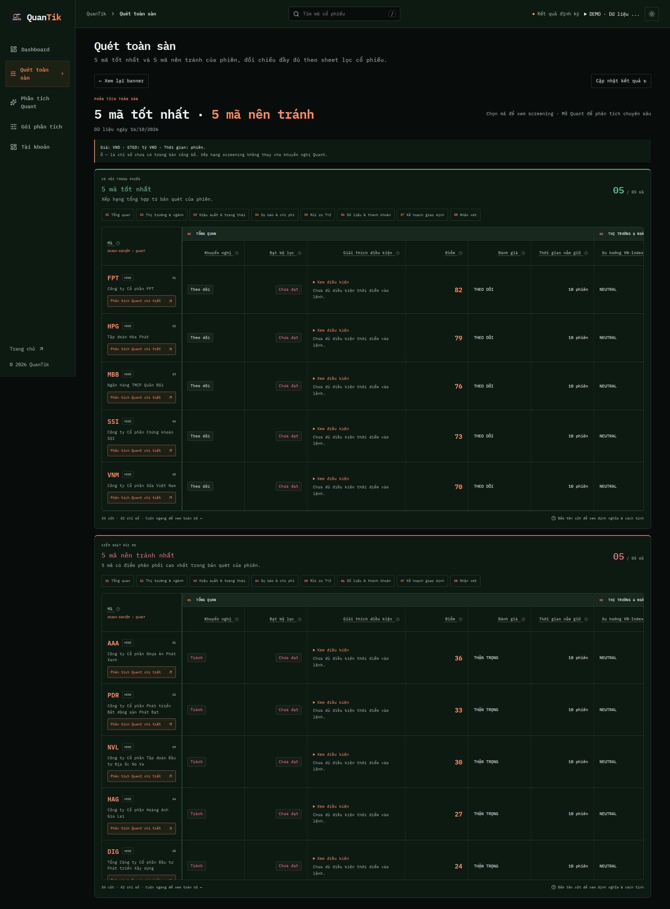
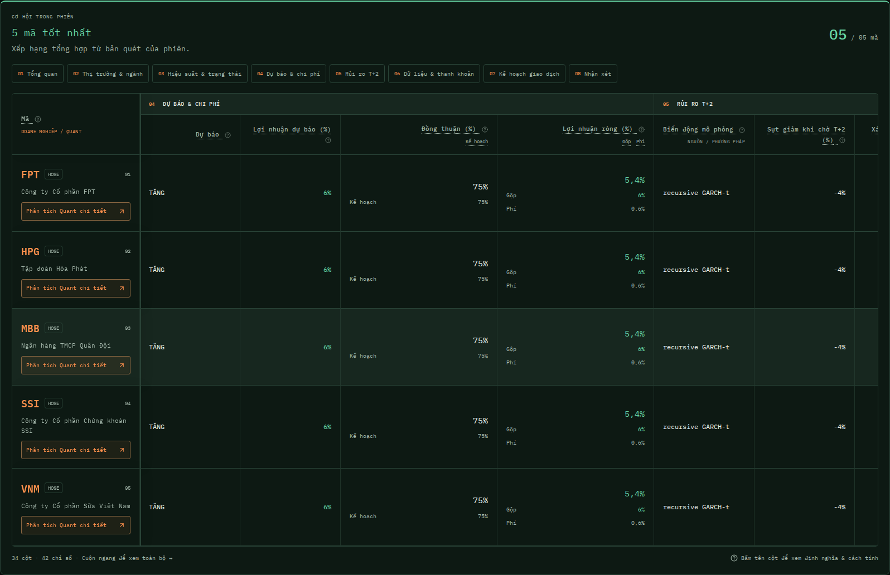

# Screening results as the stock-filter Summary sheet

After activation, `/screener` shows two full-width, five-row tables. Both contain
all 42 requested Summary metrics in 34 visible columns. Related fields are merged
without dropping their individual values or glossary definitions. Eight column bands
and jump buttons help navigate the wide sheet without hiding columns. The first
column stays frozen and contains the ticker, company name and a direct link to
the existing Quant request page. Tickers retain the screening detail modal.

Every header opens a hover/focus/click glossary with definition, method, variables,
example and interpretation. Header panels render outside the scrolling table;
Escape and outside clicks dismiss them. Long gate reasons, data flags and
commentary expand in their cells. Typography uses IBM Plex Mono and existing
dark/light theme tokens.

## Data boundaries

No backend, proxy, ranking, job, entitlement or quota changes. Existing reads:

- `GET /api/v1/screenings/latest`
- `GET /api/v1/screenings/{run_id}/results?group=OVERALL|DISTRIBUTION`
- `GET /api/v1/screenings/{run_id}/symbols/{symbol}` when opening a ticker

The existing endpoint determines membership and order: OVERALL supplies the best
five; DISTRIBUTION supplies the five with highest distribution scores. A risk
group label is not a Quant AVOID recommendation. Groups can overlap. Refreshes
retain their actual publication date; an open modal stays pinned to its run.

`ScreeningItem` accepts optional flat presentation fields listed in
`frontend/src/content/screening-sheet.ts`, and optional `name` / `company_name`.
These declarations do not make the existing backend publish those fields.
The current screening contract only guarantees basic prices, volumes, group
scores and eligibility. Until richer fields are published, their cells show `—`
and a missing company name reads “Chưa có tên công ty”. No mock fallback,
automatic analysis, report-history lookup or cross-session merge is used.

In particular, `eligible` is not `gate_pass`, and the screening group percentages
are not the Quant `score`. Missing flags are not an empty list; an explicit
empty list shows no flags/blocking conditions. Missing NAV context stays missing.
The row's Quant link navigates to `/analysis?symbol=...`, where the existing
request flow checks availability and asks the user to submit. Viewing this sheet
does not create an analysis job.

## Units and method references

Field order and keys follow `shared/scan-fields.json` in
`kwuangyong/QuanTik-website` (blob `cace443870c206022f14417d2a59055314c21801`),
limited to the 42 requested fields. No unrequested factor columns are inserted. Gross/cost/net share the net-return
cell; DQ status/score/flags share a quality cell; liquidity tier/ADV20/capacity/gap
share a liquidity cell; forecast/trade agreement share one column. Secondary
header links explain each merged metric separately.
Education text was checked against that repository's `backend/quant_engine/quant.py`
(blob `94bfdd7da6d1616093d315eb10dc3c31a525b864`) and `backend/scan_presentation.py`
(blob `b7ba511b625649b88ba9333339bd9082ac6aa0a1`). The original legacy glossary is
unchanged; the sheet passes explicit definitions into the existing TermHint.

- Prices: source VND, display VND. Unlike Excel, do not divide Entry/SL/TP by 1,000.
- Percentage fields: source percent points, append `%` without multiplying by 100.
- ADV20 value: source VND, divide by 1e9 to display billions.
- Sector correlation: coefficient in [-1, 1], no percentage conversion.
- Win Rate: retained requested header, with visible “Tỷ lệ phiên tăng” subtitle;
  source is the proportion of positive-return sessions, not winning trades.
- MCVol: source/method label, not a numerical volatility percentage.
- LockDD: fifth percentile of simulated minimum return during the lock window.
  P(loss >3%) uses the same minimum-return window, not terminal return or NAV.
- Model Agreement can duplicate forecast Agreement in the reference core.

The sheet never recomputes financial metrics or infers trade actions. Method
explanations describe the referenced core; actual parameters follow the published
report/model version.

## Validation

TypeScript, production build, Node checks and preview export cover compilation
and original glossary preservation. Desktop/mobile screening browser cases cover
34 cells / 42 metrics, five-row limits, missing fields vs false/zero, exact unit formatting,
name and Quant links, pinned ticker while scrolling, group navigation, glossary
rendering/dismissal, expanded commentary, refresh/error/access states, and no
implicit Quant requests. Browser data is synthetic test data, not a live signal.

Verified: 106 desktop/mobile browser cases, 18 Node checks, TypeScript, production
build and preview export passed. All 42 new formulas also passed strict KaTeX
rendering. Local browser checks used Chromium Headless Shell 141 with the existing
Playwright runner because the runner's newer browser download was unavailable.

The screenshots below use synthetic values for visual review only:

